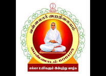
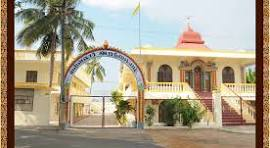

{width="0.8887248468941382in"
height="0.6354166666666666in"} **அறநிலைய நிகழ்வுகள்**
{width="1.09375in"
height="0.6616141732283465in"}

பெண்ணாடம் வள்ளலார் அறநிலையம் கடலூர் மாவட்டம் திட்டக்குடி வட்டத்திலுள்ள பெண்ணாடம் என்னும்
ஊரில் இயங்கிவரும் ஆதரவற்ற முதியோர் மற்றும் மாணவர் வாழ்விடமாகும்.

இவ்வறநிலையம் இங்கு வசிக்கும் முதியவர் மற்றும் மாணவர் நலனை பேணுவதோடு
தமிழ்வளர்ச்சி,மருத்துவம்,சுற்றுப்புற மாணவர் நலன்,சுற்றுசூழல் நலன் குறித்து பல்வேறு
சமூக தொண்டுகள் ஆற்றும் நிறுவனமாகும்.

இங்கு மாத மாதம்,ஆண்டுதோறும் எனப் பல்வேறு நிகழ்வுகள் அறநிலைய வளாகத்திலும் zoom
தளத்திலும் நிகழ்ந்து வருகிறது. இந்நிகழ்வுகளில் வாசகர்களும் கலந்து கொண்டு பயன்பெறலாம்.

**மே மற்றும் ஜூன் 2026 இன் இலவச ஹோமியோபதி மருத்துவ முகாம்**

இது ஒரு மாத மாதம் நடைபெறும் நிகழ்வாகும்.ஒவ்வொரு மாத பூசத்தன்றும் இம்மருத்துவ முகாம்
நடைபெற்று வருகிறது.

இது திரு **Dr.Arul MD** ஓமியோபதி பட்டம் பெற்ற ஓமியோபதி மருத்துவரால்
நடத்தப்படுகிறது.இது பக்க விளைவுகள் இல்லாத மருத்துவமாகும்.

பெண்ணாடம் சுற்றுவட்டாரத்தில் உள்ள பொதுமக்கள் பயனடைந்து வருகின்றனர்.இதில் மருந்துகளும்
இலவசமாகவே வழங்கப்படுகிறது.

{width="3.1770833333333335in"
height="2.3020833333333335in"}{width="3.1041666666666665in"
height="2.28125in"}

**மாதப்பூசம் -விளக்கு வழிபாடு மற்றும் மாதப்பூசம் -அன்னதானம் -மே மாதம் 2026**

{width="3.0833333333333335in"
height="2.0722222222222224in"}{width="2.8847233158355206in"
height="2.061111111111111in"}

{width="2.8020833333333335in"
height="2.2083333333333335in"}

இது மாத பூச நாளன்று அறநிலையத்தில் நடைபெறும் நிகழ்வாகும்.

இதில் பெண்ணாடம் சுற்றுவட்டாரத்திலுள்ள மகளிர் கலந்து கொள்கின்றனர்.

இவ்வழிபாட்டுக்கு தேவையான பொருட்கள் அறநிலையமே வழங்குகிறது.

வழிபாட்டு நிறைவில் பொதுமக்களுக்கும் வழிபாட்டில் கலந்துகொள்வோருக்கும் அன்னதானம்
வழங்கப்படுகிறது.

**ஜூன் மாதம் 2026 நெய்வேலி புத்தக கண்காட்சி**

{width="3.0409722222222224in"
height="2.1659525371828523in"}{width="3.1458333333333335in"
height="2.145138888888889in"}

{width="4.674599737532809in"
height="2.3645833333333335in"}

சென்ற மாதம் அறநிலைய மாணவர்கள் நெய்வேலியில் நடந்த அறநிலைய புத்தக கண்காட்சிக்கு
அழைத்து செல்லப்பட்டு அறநிலைய நூலகத்துக்கு சில புத்தகங்களும் வாங்கப்பட்டன.

**மாணவர் பொது மற்றும் இரத்த பரிசோதனை 2026**

{width="2.8645833333333335in"
height="2.5722222222222224in"}{width="3.25in"
height="2.551388888888889in"}

{width="4.13125in"
height="2.4270833333333335in"}

அறநிலைய வளாகத்தில் மாணவர்களுக்கு மருத்துவப் பரிசோதனை நடத்தப்பட்டது. இதில் மாணவர்களை
பரிசோதித்து அவர்களின் உடல் ஆரோக்கியத்திற்கு தேவையான மருந்துகள் வழங்கப்பட்டது.
